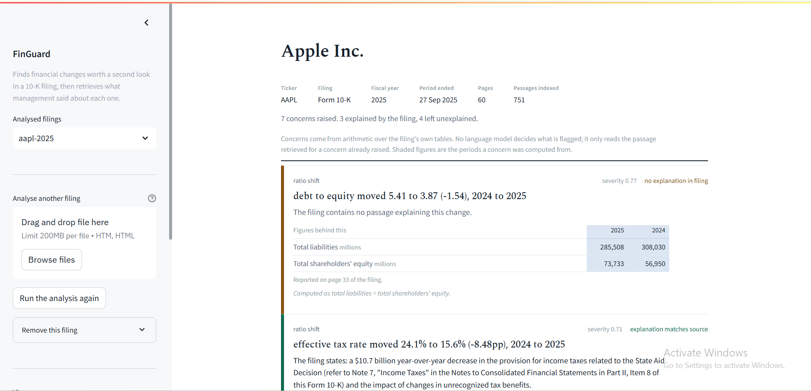

# FinGuard AI

Finds unusual financial changes in an SEC 10-K filing by arithmetic, then
retrieves and verifies what management wrote about each one.

Built for the Natural Language Processing Lab (TEE7100), Symbiosis Institute
of Technology, Pune. Faculty: Dr. Payal Kadam.

---

## The claim

A language model should not be the component that decides what is suspicious.

In FinGuard, anomalies are found by arithmetic over figures parsed from the
filing's own tables. A model is admitted only afterwards, and only to extract
what the document says about a finding that already exists. Its output is then
checked against the passage it cited by a separate entailment model.

The consequence that matters: because the finding exists _before_ retrieval
runs, the system can report that a filing contains **no explanation** for a
change it detected. A question-driven tool cannot produce that output, because
without a question there is nothing whose absence can be noticed.

---

## Pipeline

```
10-K filing (HTML)
        |
 1. Document layer      parse -> linearize tables -> chunk
        |               BeautifulSoup + our own code
        v
 2. Index and search    MiniLM embeddings -> FAISS (top 20) -> cross-encoder (top 3)
        |                                                   the R in RAG
        v
 3. Detection           metric series -> five arithmetic rules -> a finding
        |               no model is involved
        v
 4. Explanation         query from the finding -> support test -> FLAN-T5 extracts
        |                                                   the G in RAG
        v
 5. Verification        DeBERTa NLI entails it from the same passage, pass 0.50
        |
        v
 6. Dashboard           concern + figures + cited passage + verdict + printable report
```

### The five detection rules

All are plain arithmetic with fixed thresholds, in `flagging/anomaly_detector.py`.

| Rule               | Fires when                                                               | Threshold                                                                                                                                 |
| ------------------ | ------------------------------------------------------------------------ | ----------------------------------------------------------------------------------------------------------------------------------------- |
| `divergence`       | two related metrics move in opposite directions                          | 10 pp gap                                                                                                                                 |
| `sustained_trend`  | a segment moves one way in every period while its parent moves the other | 12 pp over the span                                                                                                                       |
| `segment_vs_total` | a segment moves against the company total                                | 8 pp gap                                                                                                                                  |
| `ratio_shift`      | a derived ratio moves sharply                                            | per ratio: gross margin 2 pp, operating margin 2 pp, effective tax rate 3 pp, R&D intensity 1 pp, current ratio 0.15, debt to equity 0.50 |
| `magnitude`        | a headline metric moves a lot, and not merely with revenue               | 15% (25% for revenue itself)                                                                                                              |

Each finding carries a `severity` score: the gap it measured divided by a fixed
scale, capped at 1.0. Severity orders findings **inside one filing**; it is not
comparable across filings and it is not a probability.

### The three gates before an explanation is shown

1. **Support test** — the passage must be prose rather than a table row, name
   the metric, use causal language, and clear the reranker threshold. This is
   what rejects a passage that only restates the number.
2. **Extraction only** — FLAN-T5 may copy from that passage; it may not invent.
3. **Entailment** — `nli-deberta-v3-small` must score the explanation as
   supported by the passage, at 0.50 or above. A different model from the one
   that wrote it, so it cannot grade its own work.

Each concern ends up labelled _explanation matches source_, _explanation
unsupported_, or _no explanation in filing_.

---

## Models

Four pretrained models, used exactly as released. **Nothing was trained or
fine-tuned**, and everything runs on a laptop CPU — no GPU, no API key, and no
data leaves the machine.

| Stage        | Model                                  | Type                             |
| ------------ | -------------------------------------- | -------------------------------- |
| Embedding    | `all-MiniLM-L6-v2` (384 dimensions)    | bi-encoder                       |
| Reranking    | `cross-encoder/ms-marco-MiniLM-L-6-v2` | cross-encoder                    |
| Explanation  | `google/flan-t5-base`                  | encoder-decoder, extraction only |
| Verification | `cross-encoder/nli-deberta-v3-small`   | natural language inference       |

Parsing, table linearization, metric extraction and all five rules are our own
code, with no model involved.

---

## Data

**FinQA** (Chen et al., EMNLP 2021) — 9,200 financial text-and-table examples
with annotated gold evidence. Used **only** to measure retrieval: the question
becomes the query, the annotated evidence is the correct answer. Never used for
training, and never loaded by the app.

**Real 10-K filings** from SEC EDGAR — five filings (Apple, Microsoft, NVIDIA,
JPMorgan Chase, Coca-Cola): 714 pages, 9,539 passages. These run the system
end to end. Coca-Cola was held back during development and opened only at the
end, as an unseen test.

### Storage

No database server. Each stage writes a file and the next stage reads it:

```
data/
  filings/<id>.htm              the filing as downloaded
  processed/<id>.parsed.json    text blocks and tables, with page and Item
  processed/<id>.chunks.json    the corpus: ~800-character passages
  processed/<id>.metrics.json   metric, period, value series
  processed/<id>.anomalies.json what the five rules found
  processed/<id>.verified.json  final results, with explanation and verdict
```

"Remove this filing" in the dashboard deletes exactly these.

---

## Install

Python 3.10 or later, CPU only.

```bash
git clone https://github.com/ahmed27dev/finguard-ai.git
cd finguard-ai
python -m venv .venv
source .venv/bin/activate      # Windows: .venv\Scripts\activate
pip install -r requirements.txt
```

The four models download from Hugging Face on first run (a few hundred MB) and
are cached afterwards.

## Run

```bash
python -m streamlit run app.py
```

Then upload a 10-K **HTML** file in the sidebar. Analysis takes a minute or
more: every passage has to be embedded.

Getting a filing: [sec.gov/edgar/search](https://www.sec.gov/edgar/search) ->
search the company -> filter to Form 10-K -> open the filing -> download the
first `.htm` document (named like `tsla-20241231.htm`). Save it as
"Webpage, HTML Only", not "Webpage, Complete".

### Running one stage at a time

```bash
python -m retrieval.parser data/filings/aapl-2025.htm
python -m flagging.anomaly_detector aapl-2025
```

The parser prints which method it used to recover page numbers, which is worth
checking on a new filing.

---

## What the dashboard shows

- **Filing header** — company, ticker, fiscal year, period end, pages and
  passages, read from the filing's own inline XBRL tags
- **Each concern** — the rule that fired, its severity, a plain verdict, and
  the figures behind it with the periods used shaded, so the arithmetic can be
  redone by hand
- **The cited passage** — with its page, Item and entailment score
- **A filter** — everything, explained, or left unexplained
- **A charts view** — concerns by severity, which rules fired, and what moved
  against what
- **A printable report** — opens in the browser; print, or save as PDF

---

## Evaluation

Retrieval, measured on FinQA:

| Setting                                        | Bi-encoder | With cross-encoder | Gain       |
| ---------------------------------------------- | ---------- | ------------------ | ---------- |
| Easy pool (distractors from the same example)  | 0.752      | 0.798              | +6.1%      |
| Pooled (distractors from the whole collection) | 0.489      | 0.580              | **+18.6%** |

Recall@3 0.533, Recall@20 0.700, Recall@50 0.774. The gap between Recall@3 and
Recall@20 puts the bottleneck in the reranker, not the retriever.

Detection and verification, on real filings:

| Measure                                      | Result                                               |
| -------------------------------------------- | ---------------------------------------------------- |
| Detection precision                          | **0.562** (9 of 16 hand-labelled flags were genuine) |
| Flags the filing explains at all             | 0.375                                                |
| Cited passage genuinely explains the finding | 0.667                                                |
| Verifier on adversarial claim/evidence pairs | 6 / 6                                                |

Apple 2025: 7 concerns, 3 explained, 4 left unexplained. Coca-Cola, never
opened during development: 1 concern, operating cash flow down 41.3%,
explanation found on page 56 with entailment 0.93.

**There is no recall or F1 for detection.** Both need a complete list of every
true anomaly in a 10-K, and no such list exists. Only precision is measurable,
and we report it as measured.

---

## Limitations

- About four flags in ten are not worth reading.
- Recall is unknown, for the reason above.
- In roughly 3 cases out of 10 the correct passage is not in the shortlist at all.
- Thresholds were tuned on three filings.
- English HTML 10-Ks only (US GAAP, inline XBRL). No PDF, no IFRS, no 10-Q.
- Page numbers are recovered heuristically: from a footer pattern where one
  exists, otherwise by counting page-break elements and calibrating that count
  against the page numbers the filing prints. Where a filing prints none, the
  number can run ahead by the length of the unnumbered front matter. The Item
  label and the passage text are always exact.
- "Unexplained" merges two cases — the retrieval missed the passage, and
  management genuinely said nothing. The system does not distinguish them.

## Next steps

Fetching a filing from EDGAR by URL; reading PDF filings; fine-tuning the
reranker on financial text; comparing a company against its own prior-year
filing; a larger labelled evaluation.

---

## Who built what

|                    |                                                                                                                                                                                                                          |
| ------------------ | ------------------------------------------------------------------------------------------------------------------------------------------------------------------------------------------------------------------------ |
| **Ahmed Mohammed** | Filing parser with page and section recovery; table linearization and scale resolution; chunking; FAISS index; cross-encoder reranking; retrieval evaluation against FinQA                                               |
| **Jay**            | Metric extraction and canonicalisation; the five anomaly rules and their thresholds; query generation and the support test; explanation generation and output validation; faithfulness verification; Streamlit dashboard |
| **Joint**          | System design and the interface between the two halves; configuration and tests; evaluation labelling; the report                                                                                                        |

---

FinGuard flags areas for review. It is not an audit, a fraud detector, or
investment advice; every concern needs a human judgement.
